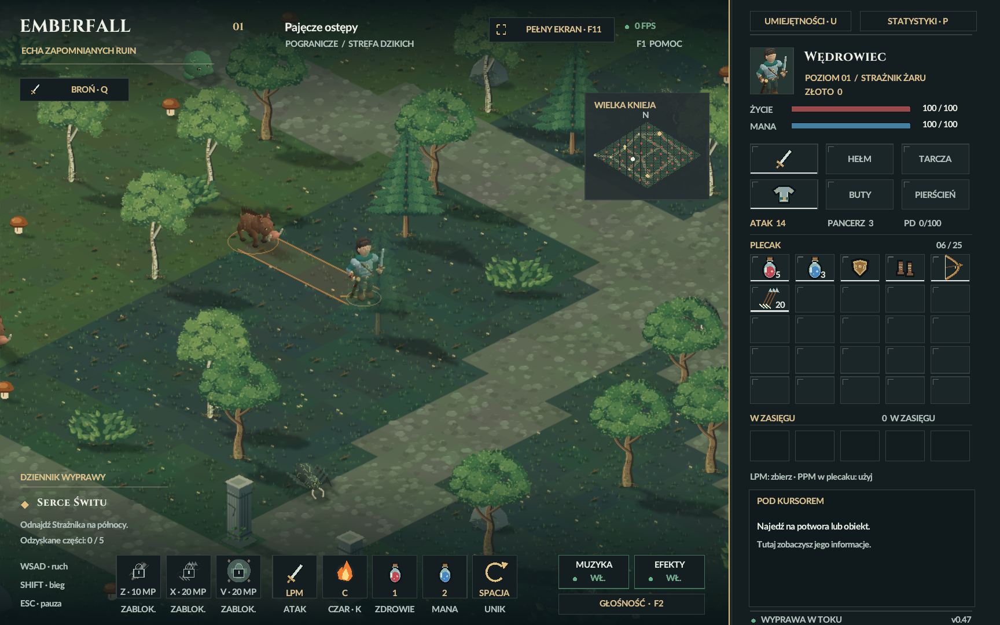

# Szarża leśnych dzików — 28.10.2026

Każdy żywy dzik pierwszej lokacji ma dodatkową umiejętność szarży.
Zwykłe ataki, statystyki, łupy i wygląd pozostałych gatunków są zachowane.

## Przebieg i balans

- Pierwsza gotowość po 0,65 s widocznej walki. Zasięg rozpoczęcia 2,2–6,5 pola,
  z widocznym graczem. Z bliska dzik używa zwykłego ataku.
- Przygotowanie 0,55 s: dzik zatrzymuje się, opuszcza łeb i pokazuje pomarańczowy
  tor na ziemi. Podczas przygotowania śledzi aktualną pozycję bohatera.
- W chwili ruszenia ustala kierunek. Biegnie prosto przez maks. 0,7 s
  z prędkością 9,5 pola/s, ponad cztery razy szybciej niż zwykły chód.
  Można zejść z toru po jego ruszeniu. W biegu pojawia się kilka smug kurzu.
- Kontakt zadaje jeden fizyczny cios: 2× obrażenia zwykłego ataku po redukcji
  pancerzem. Również minimalne obrażenia przeciw wysokiej obronie są podwójne.
  Chroniona część przeturlania zużywa kontakt bez obrażeń; późna część nie chroni.
- Dzik przebiega obok bohatera, lecz zatrzymuje się na roślinach/przeszkodach,
  skrzyniach, żywych bestiach i granicy mapy. Po szarży odpoczywa 0,6 s.
- Odnowienie 4,5 s od ruszenia. Po nim potrzebne jest następne przygotowanie.
  Czas gotowości biegnie podczas aktywnej walki; poza nią nie wymusza ataku.

## Implementacja i zasoby

`src/boar_charge.hpp`, integracja AI/ruchu w `src/game.hpp`.
Prędkość i wszystkie czasy są stałymi w `game.hpp`. Ruch korzysta z istniejących
podkroków 120 Hz oraz ciągłego testu odcinka względem przeszkód i poruszającego
się bohatera. Wstępny test granic odrzuca dalekie obiekty. Nie powstają nowe
tekstury, nie ma generowania plików ani zasobów w pętli klatek.

Ponownie wykorzystano istniejące pozy ataku dzika, chód zależny od rzeczywistej
drogi, geometrię i lokalne dźwięki gry. Nie dodawano modelu ani nowych grafik
źródłowych. Wskaźnik kierunku i trzy ograniczone drobiny kurzu używają istniejących
prymitywów renderera. Bez płatnych usług, zewnętrznych zasobów i nowych licencji.
Panel pod kursorem opisuje szarżę.

Śmierć dzika/bohatera i podróż anulują aktywną szarżę. Pauza symulacji zachowuje
stan. Format zapisu **v8** przechowuje przygotowanie, kierunek, bieg, już zużyte
trafienie, odpoczynek i cooldown. Odczyt v1–v7 dodaje bezpieczne wartości domyślne,
bez zmiany ekwipunku i dotychczasowego postępu. `fixtures/legacy-v7.efs` to rzeczywisty
zapis z wcześniejszego, odizolowanego testu; nie jest zapisem użytkownika.

## Weryfikacja

`tests/boar_charge_tests.hpp`: trafienie tylko raz, podwójne obrażenia również
przy dużym pancerzu, 30/60/120 Hz, aktualny cel przy ruszeniu, zablokowany kierunek,
ominięcie/uniki, przecięcie ruchu gracza, przeszkody, skrzynie, bestie, brzeg,
ponowne użycie po cooldownie, śmierć/podróż/pauza, brak wpływu na oba RNG.
Test zwykłej prędkości pościgu ma wyłączone umiejętności specjalne w swoim fixture.

`tests/boar_save_tests.hpp`: prawdziwy zapis v7, dokładny zapis/wznowienie pięciu
faz szarży oraz odrzucanie nieprawidłowych zegarów, kierunków i faz.

Uruchomienia:

```powershell
pwsh -NoProfile -File build.ps1 -Test
pwsh -NoProfile -File tests/boar_charge_qa.ps1 -NoAudio
pwsh -NoProfile -File package.ps1
pwsh -NoProfile -File tests/boar_charge_package_qa.ps1 -NoAudio -HelperRoot <folder-helpera>
```

Test graficzny używa rzeczywistego kodu wersji gracza, wykonuje 163 kontrole,
obejmuje osiem kierunków, 35 klatek wszystkich faz, spotkanie w oryginalnym
lesie oraz rzeczywisty wybór sylwetki myszą i rozmiar opisu w HUD. Okno przez cały czas jest ukryte,
urządzenie audio nie jest otwierane. Czas renderowania ukrytego okna jest
diagnostyką kosztu sceny; nie stanowi pomiaru FPS wyświetlania na ekranie.

Przed zmianami zachowano źródła i poprzednią paczkę w
`art/pipeline/backups/boar-charge-20261028`.

Końcowy `build.ps1 -Test`: **158740** kontroli logiki/animacji i **3695**
kontroli zapisów — PASS. Obejmuje też możliwość ruszenia od przeszkody,
której ciało dzika dotyka od tyłu, przy małym błędzie zaokrąglenia pozycji.
Wyniki graficzne: `renderer.json`, `render-checks.txt`. Wyniki kontroli ZIP-a:
`package-verification.json`. Utrwalone sumy źródeł: `source-manifest.json`.

Końcowa paczka została wypakowana i sprawdzona: zgodność 115 plików zasobów,
180 klatek normalnego startu wersji gracza i ponownie 163 kontrole szarży — PASS.
W archiwum nie ma helperów testowych ani źródeł narzędzi graficznych.
Okna pozostały ukryte, a zapisane preferencje dźwięku nie zmieniły się.


