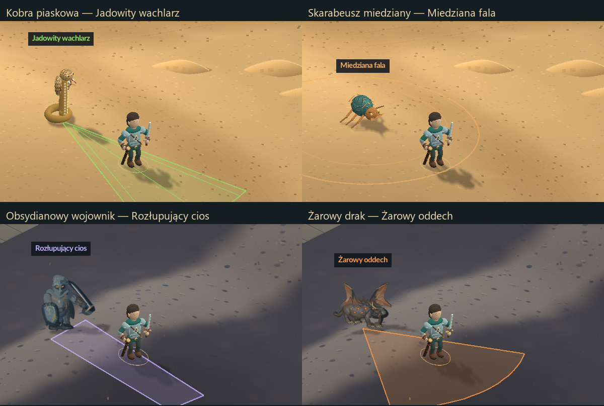

# Zdolności pustyni i Kaldery — 08.11.2026

Po dwa najsilniejsze zwykłe gatunki w każdej krainie otrzymały osobne ataki.
Bossowie zachowują Piaskowe Więzienie i erupcje, a dzik swoją szarżę.

| Przeciwnik | Zdolność | Przygotowanie / działanie / odpoczynek | Obrona |
| --- | --- | --- | --- |
| Kobra piaskowa | Jadowity wachlarz: trzy rozchodzące się pociski magiczne | 0,75 / 0,15 / 0,55 s | Zejście z toru, unik, osłona |
| Skarabeusz miedziany | Miedziana fala: rozszerzający się pierścień | 0,85 / 0,70 / 0,70 s | Wycofanie, przeturlanie przez falę, osłona |
| Obsydianowy wojownik | Rozłupujący cios: mocne uderzenie w pasie przed sobą | 1,05 / 0,18 / 0,85 s | Zejście na bok, unik, osłona |
| Żarowy drak | Żarowy oddech: stożek ognia, trzy impulsy obrażeń magicznych | 0,95 / 1,05 / 0,65 s | Wyjście ze stożka, obejście bestii, osłona |

Kierunek jest ustalany na początku przygotowania. Potwór nie obraca ataku
za uciekającym bohaterem. Znacznik na ziemi i nazwa informują o nadchodzącym
ataku; w fazie odpoczynku przeciwnik nie chodzi ani nie używa zwykłego ciosu.
Odnowienie liczone od rozpoczęcia: odpowiednio 6,2 / 7,2 / 7,8 / 7,5 s.
Pierwsze użycie wymaga trzech sekund widocznego kontaktu. Zdolności działają
również w zwarciu po zakończeniu zwykłego ataku. Pierścień i wachlarz mogą
trafić najwyżej raz na użycie; oddech ma trzy słabsze impulsy. Jad nie dodaje
osobnego zatrucia w czasie. Śmierć właściciela i podróż przerywają ataki.

Zapis **v11** przechowuje fazę, kierunek, odnowienie, maskę zdarzeń i pociski.
Odczyt v1–v10 pozostaje dostępny; nowe zdolności startują w stanie spoczynku.
Format zachowuje również kontekst rozmowy z Eldrinem z poprzedniej aktualizacji.
Nie zmieniono przedmiotów, tabel łupu, punktów doświadczenia ani strumieni RNG.

Efekty są rysowane procedurami 2D z kodu, nad istniejącym podłożem i jego
profilami wysokości. Wykorzystują obecne malowane postacie, rigi i klipy
Synfig oraz istniejące dźwięki. Nie powstały nowe bitmapy, modele, klipy ani
zależności. Nie użyto usług chmurowych. Kopie sprzed zmian:
`art/pipeline/backups/elite-abilities-20261108`.

Odbiór: `tests/enemy_ability_tests.hpp`, `enemy_ability_save_tests.hpp`,
`enemy_ability_qa.ps1 -NoAudio`, `enemy_ability_package_qa.ps1 -NoAudio`.
Każde uruchomienie graficzne jest ukryte i bez audio; ustawienia użytkownika
pozostają niezmienione. Wyniki końcowe i sumy plików: `QA.json`.

PASS: 200119 kontroli logiki/animacji, 5162 zapisu, 497 renderera. Renderer
obejmuje osiem kierunków każdej zdolności, 105 obrazów oraz cztery spotkania
w oryginalnym terenie. Po rozpakowaniu obu ZIP-ów potwierdzono zgodność
EXE i po 147 zasobów. Wersja gracza przeszła 180 klatek startu i ponowne
497 kontroli zdolności z zasobami z ZIP-a; DEV — po 180 klatek trzech krain.
Żaden test nie otworzył audio ani nie zmienił jego preferencji. Testy ukryte
nie są pomiarem foreground FPS.

