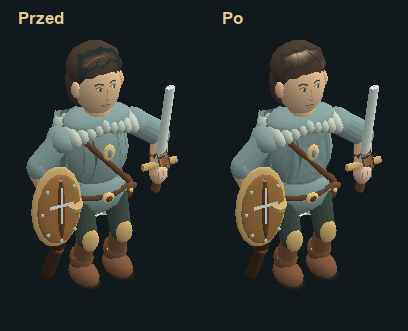

# Wędrowiec — malowanie ComfyUI, 05.11.2026

Nowe pasma włosów, tkanina tuniki, karwasze i buty są częścią używanego
przez grę atlasu `assets/sprites/hero-paints.png`. Pięć renderów img2img
powstało lokalnie przez `comfy_local` w ComfyUI 0.44.0 na CPU, z użyciem
DreamShaper 8, LCM-LoRA i ControlNet Canny. Dopasowano kolor pasm do
korony włosów, a przy malowaniu tuniki i butów wykorzystano luminancję
tekstur, żeby renderer dalej nadawał im kolory wyposażenia.

Atlas zachowuje format 512 × 384 RGBA, komórkę twarzy i układ UV. Włosy
i karwasze mają oryginalne maski. W komórkach tuniki i butów dodano
wycieniowane wypełnienie wnętrza paneli. Istniejący rig, animacje oraz
dobór modeli sprzętu używają tej samej tekstury co dotychczas.

`hero-materials.kra` zawiera sześć warstw. Zapis Krity sprawdzono pod
względem zgodności widocznych pikseli i alfy z atlasem runtime. Wejścia,
oryginały, skrypty, natywne PNG z ComfyUI i kopie obu poprzednich paczek
są w `C:\AI2D\sprites\emberfall-hero-comfy-20261105`. Użyte grafy, źródła
wag i sumy kontrolne znajdują się w `workflows/` i `provenance.json`.

Testy ukryte i bez dźwięku. Renderer przeszedł 424 kontrole, w tym 420
ujęć siedmiu rodzajów ruchu oraz ujęcia z ośmiu kierunków. Obie paczki
uruchomiono po wypakowaniu przez 180 klatek. Test wersji gracza powtórzył
pełne 424 kontrole. Wyniki są w `QA.json` i `render-comparison.json`.
