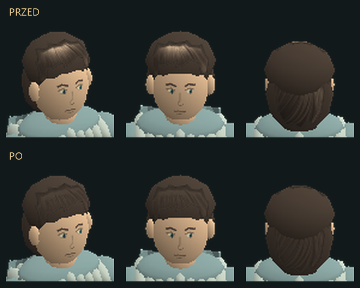

# Jednolity kolor włosów — 07.11.2026

Usunięto jasną plamę nad czołem bohatera. Pasma przodu i tyłu mają wspólny
ciemny brąz, zgodny z koroną fryzury, oraz delikatny kontrast szczegółów.
Wcześniejszy szeroki refleks z tekstury nakładał się na oświetlenie głowy.



Korekta materiału w `src/hero_paint.hpp` działa raz podczas wczytywania
atlasu. Odejmuje szerokie różnice jasności, zachowuje miejscowy rysunek
pasm i ujednolica barwę obu komórek włosów. Renderer używa tego samego
koloru bazowego w `src/hero_art.hpp`. Brak dodatkowych tekstur, geometrii
i obróbki pikseli w pętli klatki. Poprawka obejmuje postać oraz portret.

Oryginalny PNG i warstwowy master KRA pozostają niezmienione. Zachowano
wszystkie piksele alfy, układ UV oraz kolory pozostałych części atlasu.
Kopie sprzed zmiany: `art/pipeline/backups/hero-hair-20261107-234137`.

Ukryte testy bez otwierania urządzenia audio: 428 kontroli renderera,
w tym 420 klatek ruchu i walki, oraz 25 niezależnych kontroli obrazów
z ośmiu kierunków. Zmiany obrazu mieszczą się wyłącznie na włosach;
obrys i pozostałe części postaci są identyczne. Szczegóły: `render-QA.json`.
Weryfikacja gotowych paczek: `package-QA.json`.

Powtórzenie z katalogu projektu:

```powershell
pwsh -NoProfile -File tests/hero_art_qa.ps1
python tools/media/verify_hero_hair.py --qa dist/qa-hero-art --output art/hero/hair --no-audio
pwsh -NoProfile -File tests/hero_package_qa.ps1
```

Rzeczywisty EXE w diagnostyce zawsze otrzymuje `--no-audio --background-test`;
helper używa ukrytego okna i nigdy nie otwiera audio. Zwykłe uruchamianie
przez użytkownika zachowuje zapisane ustawienia dźwięku.
