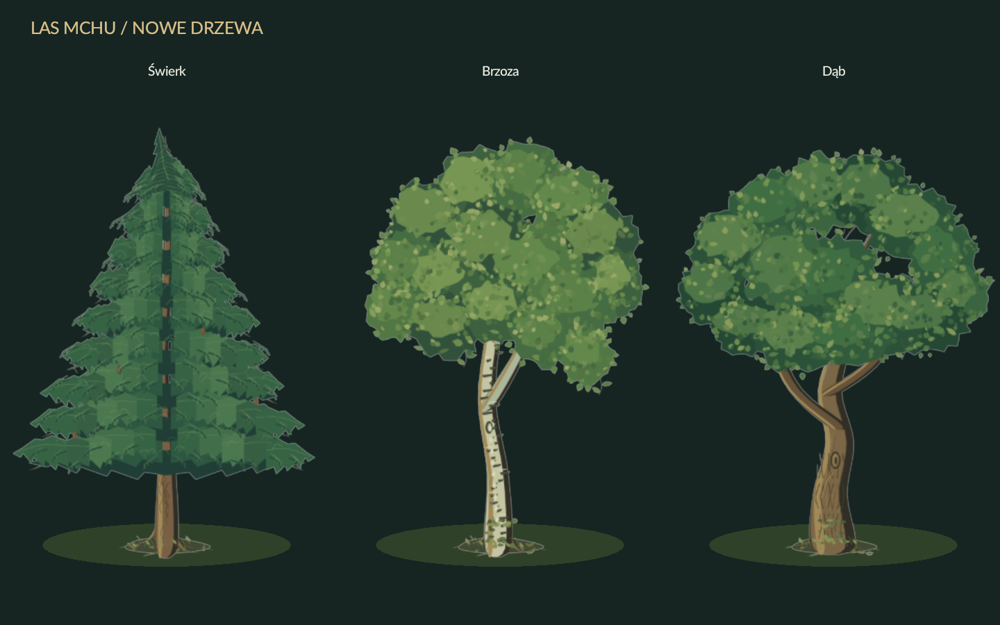
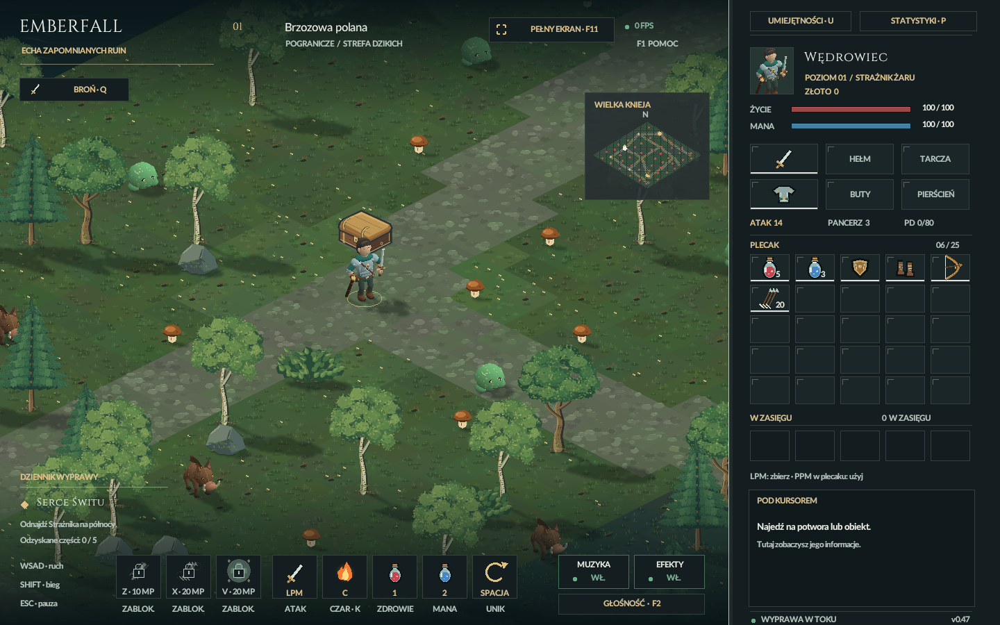

# Leśne drzewa — 23.10.2026

**PASS:** nowe grafiki są podłączone do gry i sprawdzone w świeżo rozpakowanej
paczce `Emberfall-Windows-x64.zip`. Wszystkie uruchomienia miały `--no-audio`.

Świerk, brzoza i dąb powstały natywnymi narzędziami istniejącego Krita MCP.
Master ma odpowiednio 8, 10 i 10 warstw malarskich, 540×690 px i przezroczyste
tło. Własne liście, igły, kora, rozwidlenia i mech; bez obrazów zewnętrznych,
modeli 3D, usług chmurowych i płatnych narzędzi. Zachowano pierwszą wersję
oraz kolejne etapy wykończenia w `C:\AI2D\sprites`.

## Rzeczywiste kontrole

- **206 kontroli renderera gracza:** trzy załadowane ilustracje, zwolnienie
  tymczasowych źródeł, bufory 360×460, kontakt korzeni z ziemią i brak obcięcia.
- **36 obrazów wiatru:** każdy z trzech gatunków w skalach 0,75 / 1 / 1,55
  oraz chwilach 0 / 0,3 / 1,1 / 2,4 s. Porównano rzeczywisty obraz GPU
  z maską kursora, pomijając tylko mieszane piksele antyaliasingu. Korzenie
  pozostają nieruchome; korony poruszają się w kolejnych próbkach.
- **Cztery widoki lasu i trzy widoki wskazywania drzewa:** rzeczywista scena,
  sortowanie, cienie i obrys pod kursorem. Obejrzano widoki lasu i zbiorczy
  podgląd trzech drzew w docelowym rendererze.
- **121 niezależnych kontroli:** pełne dekodowanie PNG, integralność KRA,
  warstwy, sumy źródeł i dostarczanych plików, identyczność pikseli zapisanego
  KRA i PNG oraz wszystkie obrazy z testu GPU.
- **87 555 kontroli logiki i animacji oraz 1124 kontrole zapisu:** PASS.
- **Świeże rozpakowanie ZIP:** 104 zasoby mają zgodne SHA-256, EXE jest wersją
  gracza, a 180 klatek rzeczywistego startu kończy się w menu głównym. Brak
  trybu deweloperskiego, aktywnego prologu i otwartego urządzenia audio.
  Zapisane w izolowanym folderze preferencje dźwięku zachowały sumę.
- Po rozpakowaniu ponownie wykonano wszystkie **206 + 121** kontroli drzew.
  W ZIP nie ma KRA, SIF, innych masterów ani programów diagnostycznych.

Wyniki: `dist/qa-forest-trees-20261023/`,
`dist/qa-trees-package-20261023-112802/package-verification.json`.
Raport zbiorczy z hashami: [TREES_QA.json](TREES_QA.json).

## Wydajność

Po 900 klatek, OpenGL/V-sync 60 Hz, okno 1440×900, natywny bufor 1688×1055,
bez dźwięku i bez jednoczesnego renderowania w programach produkcyjnych:

| Pomiar | Przed | Po |
| --- | ---: | ---: |
| Las — średnie FPS | 54,3958 | 54,3073 |
| Las — średni czas CPU | 11,1531 ms | 10,7678 ms |
| Las — CPU P95 | 13,7662 ms | 13,4399 ms |

Kontrolna pustynia po zmianie: 59,6093 FPS, CPU średnio 6,46387 ms.
Wydajność lasu pozostała praktycznie na wcześniejszym poziomie. Ten pomiar
**nie potwierdza stałych 60 FPS**; P95 całej klatki po zmianie to 23,4905 ms.
Detal nie zwiększa liczby wierzchołków ani etapów rysowania wiatru.

Trzy bufory drzew zajmują 1 987 200 bajtów RGBA8. Wzrost buforów i obrysów:
2 980 800 bajtów GPU (2,84 MiB), a masek CPU: 372 600 bajtów. Źródła są
zwalniane po wypaleniu; bez odczytu plików i generowania grafiki w klatce.

Surowe pomiary: `dist/qa-tree-benchmark-20261023/` oraz
`art/pipeline/backups/forest-trees-20261023/benchmark-before.txt`.

## Źródła i odtworzenie

[README.md](README.md) opisuje narzędzia i polecenia. Mastery i pochodzenie:
`art/scenery/trees/`; produkcyjne logi MCP i pierwsze wersje:
`C:\AI2D\sprites\emberfall_forest_trees_20261023_v1`, `_v2` i `_v3`.
Przerwane połączenie przy podglądzie zostało sprawdzone przez `krita_state`;
wznowienie wykorzystało potwierdzone wyniki rysowania. Finalne podglądy i zapis
wszystkich trzech dokumentów przeszły kontrolę. Zamknięto tylko własne dokumenty.

Kopia poprzedniej paczki i plików implementacji:
`art/pipeline/backups/forest-trees-20261023/`.

