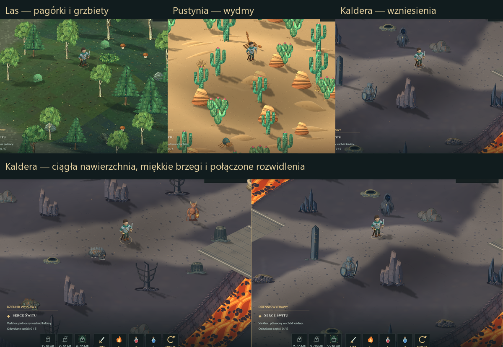

# Urozmaicony teren i ciągłe ścieżki Kaldery — 08.11.2026

Rozbudowa poprzednich 13 wzniesień do 44 form terenu: 14 w lesie, 14
na pustyni i 16 w Kalderze. Niskie pagórki przeplatają się z większymi
kopułami, wydłużonymi grzbietami i przełęczami pomiędzy sąsiadującymi
wzgórzami. Parametry różnią się wysokością oraz promieniami obu osi.
Najwyższy teren osiąga 3,6 jednostki, czyli 115,2 piksela rzutu ponad
równiną. Zachowano wspólny model fizycznej wysokości dla podłoża,
bohatera, przeciwników, obiektów, cieni i kursora.

`src/terrain_height.hpp` przechowuje całą rzeźbę terenu. Niższe formy
częściowo łączą się z większymi, tworząc łagodne siodła. Przy lawie
profil wygasza się szerzej, aby nowa gęstość wzgórz nadal zapewniała
czytelne zbocza i jednoznaczne wskazywanie terenu. Oaza, koryta lawy i mosty pozostają
na poziomie bazowym. `layout.json` zawiera wynik próbkowania co 0,2 pola:
14,54 / 11,61 / 10,12 minimalnej wartości jakobianu rzutu lasu, pustyni
i Kaldery. Udział powierzchni podniesionej o ponad 0,15 jednostki wynosi
odpowiednio 52,4% / 47,4% / 33,7%.

Ścieżki Kaldery mają teraz zaokrąglone zakręty i jedną ciągłą nawierzchnię
także na skrzyżowaniach. `src/volcano_roads.hpp` wygładza przebieg wewnątrz
marginesu istniejących dróg. Wszystkie 87 krótkich odcinków korzysta
z tego samego materiału w ciągłych współrzędnych świata. Odległość od
całej sieci tworzy wspólną maskę, więc odcinki nie nakładają osobnych,
przyciemnionych pasów i nie zostawiają szczelin w połączeniach.
Brzegi mają miękkie, nieregularne przejścia w popiół. Trasy prowadzą
przez dotychczasowe mosty; rozmieszczenie obiektów i kolizje są zachowane.

Nowy materiał `assets/volcano/road.png` wykonano lokalnie w Kricie 5.3.4,
na czterech edytowalnych warstwach: ubity popiół, zaokrąglone fragmenty
bazaltu, drobne rysy i rozsypany żwir. Natywny master 1024×1024 i eksport
512×512 pozostają w `C:\AI2D\sprites\emberfall-caldera-road-20261108-v1`.
Produkcja: `tools/media/krita_caldera_road.py`, istniejący lokalny worker
kritarunner, bez nowych serwerów, chmury i zewnętrznych obrazów. Dokument
zapisano i zachowano w tle. `krita-receipt.json` zawiera rzeczywisty stan
przed i po pracy, listę warstw i hashe źródła/eksportu. Zasób można
rozpowszechniać z grą; nie wymaga dodatkowych licencji zewnętrznych.

Wypiek używa chwilowej maski 576×576 (1,27 MiB RGBA8), zwalnianej po
przygotowaniu terenu. Materiał nadal zajmuje 1 MiB, a liczba tekstur
właściwej klatki gry nie rośnie. `src/volcano_road_art.hpp` łączy materiał
i maskę w istniejącym buforze podłoża. Poprawne mieszanie alfa podczas
całego wypieku zachowuje nieprzezroczysty grunt pod miękkimi brzegami
i popiołem. Usuwa to prześwity odległego tła, które dawały smugi na
pochyłościach. Zewnętrze Kaldery pozostaje przezroczyste dla przepaści.

Odbiór: `tests/hills_qa.ps1 -NoAudio` obejmuje wszystkie 44 wzniesienia,
fizyczny ruch w górę/w dół, dostępność od rzeczywistego wejścia z aktywną
scenografią, stopy po przebiegu cieni, kursor w pięciu skalach, krycie
podłoża, ciągłość dróg i przejścia przez lawę. Izolowane próby ruchu usuwają
drzewa, skały i wrogów wyłącznie na potrzeby rejestracji; normalna gra je
zachowuje. `tests/terrain_render_layers_qa.cpp` rozdziela etapy renderowania
do diagnozy obrazu. Wszystkie okna pozostają ukryte, urządzenie audio
jest wyłączone, preferencje użytkownika są zachowane. Czasy ukończonego
renderowania nie dowodzą płynności prezentacji widocznego okna.

`tools/media/verify_caldera_road.py` sprawdza rzeczywisty KRA, warstwy,
dekodowanie, zgodność eksportu z runtime oraz szwy powtarzanego materiału.
Nie jest potrzebna migracja zapisów. Poprzednie źródła, materiał ścieżki
i obie paczki: `art/pipeline/backups/terrain-roads-20261108`.

Odrzut po uderzeniu Strażnika zachowuje zapisany wektor przesunięcia XY,
także na nowych stokach. Wysokość stóp nadal podąża za powierzchnią.
Oddzielono ten wymuszony impuls od tempa chodzenia po zboczu, aby
zachować dotychczasowy zasięg odrzutu i zgodność zapisów. Kontrola obejmuje
rzeczywiste zbocza trzech krain przy 30/60/120 Hz. Testy chodzenia,
sprintu, patrolu i uniku mierzą teraz pokonaną drogę po powierzchni,
zamiast zakładać płaskie podłoże w dawnych współrzędnych areny.

Wyniki źródłowego wydania gracza: 1584 kontrole wzniesień i dróg oraz
1063 regresje renderera Kaldery — PASS. Własny materiał: 13 niezależnych
kontroli rzeczywistego KRA i PNG — PASS. Średni ukończony render sceny
w teście wzgórz: 4,11 ms; p95 4,85 ms. Wyniki i logi są w plikach
`renderer-QA.json`, `renderer-checks.txt`, `volcano-QA.json` i `asset-QA.json`.
Logika i animacje: 200013 kontroli, zapis i odczyt: 4513, obsługa skrzyń
w rzeczywistym interfejsie: 115 — PASS.
Przebudowano oba EXE i ZIP-y. Po wypakowaniu sprawdzono po 147 zasobów
w każdej paczce, ich zgodność z katalogiem `assets` i hashe EXE.
Rzeczywisty EXE gracza przeszedł 180 klatek startu, DEV po 180 klatek
lasu, pustyni i Kaldery. Ten sam helper podłoża/dróg powtórzył 1584
kontrole na zasobach z paczki gracza. Preferencje dźwięku pozostały
niezmienione zarówno w paczkach testowych, jak i lokalnym `dist`.
Szczegóły: `package-verification.json` i `validation.json`.
