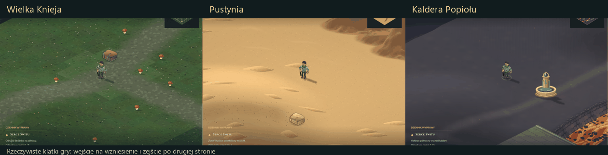

# Wzniesienia trzech krain — 08.11.2026

13 dostępnych wzniesień: cztery leśne pagórki, cztery pustynne wydmy
i pięć bazaltowych wzgórz Kaldery. Mają wspólną, rzeczywistą wysokość
w świecie, łagodne wejścia i zejścia. Szczyty leżą od 1,7 do 3,3 jednostki
nad równiną, co odpowiada 54–106 pikselom rzutu przed ruchem kamery.

Podgląd zestawia po 60 rzeczywistych klatek trzech krain. Drzewa, skały
i przeciwników usunięto wyłącznie w tych izolowanych próbach ruchu,
aby pokazać cały przebieg zbocza. Normalna gra zachowuje scenografię.
Osobna kontrola dostępności szczytów uwzględnia rzeczywiste kolizje.

`src/terrain_height.hpp` zawiera kanoniczne profile wysokości, gradienty
i pomiar odległości po powierzchni. Korzystają z nich bohater i przeciwnicy.
Ruch zachowuje prędkość wzdłuż zbocza; wysokość wynika z pozycji XY.
Starsze zapisy nie wymagają migracji ani rozpoczęcia nowej wyprawy.

`src/terrain_surface.hpp` podnosi wierzchołki podłoża i nadaje zboczom
światło według nachylenia. Wykorzystuje istniejące ilustracje i bufory
terenu, bez nowych modeli, grafik rastrowych lub bufora wielkości mapy.
Siatki i oświetlenie są przygotowywane raz, a niewidoczne komórki pomijane.
Postacie, przedmioty, skrzynie, rośliny i dekoracje stoją na tym samym
profilu. Cienie dopasowują się do pochyłej powierzchni. Geometria postaci
przygotowana przez przebieg cieni otrzymuje właściwą podniesioną kotwicę.

Kamera częściowo podąża za wysokością; bohater wyraźnie wznosi się
w kadrze. Odwrotny rzut kursora przecina profil terenu, dzięki czemu
wskazywanie obiektów i celowanie działa także na szczytach i zboczach.
Obrys pod bohaterem oraz podświetlenie pola również śledzą wysokość.
Wszystkie profile mają jednoznaczny rzut bez zawijania powierzchni.
Koryta lawy i mosty pozostają poziome, podobnie jak osobne piętra wieży.

Odbiór: `tests/hills_qa.ps1 -NoAudio` sprawdza wszystkie szczyty, trasy
z kolizjami, przejścia bohatera i przeciwnika, prędkość po powierzchni,
kursor w pięciu skalach obrazu, rzeczywiste piksele stóp po przebiegu
cieni, koryta lawy i wieżę. `renderer-QA.json`, `renderer-checks.txt`
i `elevations.json` przechowują wyniki i wysokości. Podglądy składa
`tests/hills_preview.py` z oryginalnych zrzutów renderera.

Wynik: 564 kontrole wysokości/ruchu/renderera, 1063 kontrole regresji
Kaldery i 115 obsługi skrzyń — wszystkie PASS. Próba renderera wysokości
zakończyła się w średnio 4,06 ms, p95 4,47 ms. Paczki sprawdza
`tests/hills_package_qa.ps1 -NoAudio -HelperRoot <katalog helpera>`.
Pełna logika: 199995 kontroli; zapis i odczyt: 4513 — PASS.
Aktualne EXE oraz oba ZIP-y przebudowano. Po wypakowaniu porównano
wszystkie 147 zasobów każdej paczki z kanonicznym katalogiem `assets`.
EXE gracza przeszedł 180 klatek startu; EXE DEV po 180 klatek lasu,
pustyni i Kaldery. Renderer ze źródła wydania gracza ponownie przeszedł
564 kontrole na zasobach z ZIP-a. Hashe i wyniki:
`package-verification.json`. Preferencje dźwięku były identyczne przed
i po testach, także w głównym folderze roboczym `dist`.

Wszystkie próby mają ukryte okna i wyłączone urządzenie audio.
Czas ukończonego renderowania w raporcie nie jest pomiarem FPS widocznego
okna ani płynności prezentacji na monitorze. Preferencje dźwięku użytkownika
pozostają zachowane. Kopie źródeł i paczek sprzed zmiany:
`art/pipeline/backups/walkable-hills-20261108`.
