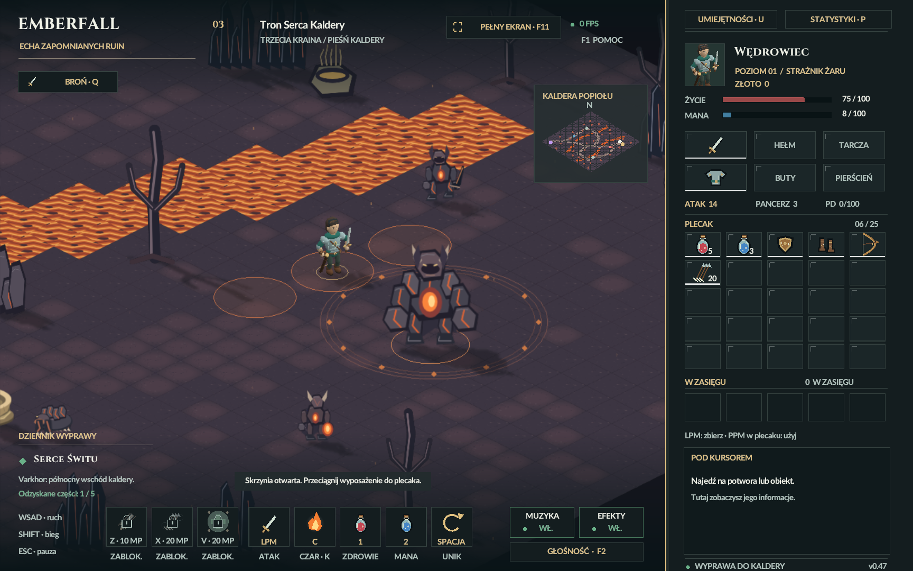

# Kaldera Popiołu — trzecia kraina, 29.10.2026

Aktualna wersja: **`river-detail/README.md`** — płynąca lawa, dodatkowe
dekoracje i detale przeciwników. Poprzednia warstwa: `polish/README.md`.
Poniższy opis źródeł i liczby testów dokumentują pierwszą wersję poziomu.
Nowe źródła, format zapisu v10 i wyniki odbioru są w `polish/`.

Pełny poziom 72×72, połączony z dotychczasową grą. Po pokonaniu Żywej Wydmy
Eldrin oferuje przy następnej rozmowie wybór **„Przenieś mnie do Kaldery
Popiołu.”**. Przycisk pustyni i pozostania w wieży nadal działają. Podróż
wymaga wyboru; samo czekanie w menu nie teleportuje postaci.

## Poziom

- Bezpieczny start (8;62), brama do wieży (8;65), boss daleko na (60;15).
- Dwie kręte rzeki lawy oddzielają części mapy. Cztery bazaltowe przejścia
  pozwalają je przekroczyć. Lawa i kapliczki blokują chód, bieg, przeturlanie
  i ruch przeciwników; wrogowie patrolują bez wchodzenia do lawy.
- Szlak do bossa oraz boczne drogi przez Pogorzelisko i Obsydianowe Kuźnie.
  Bazalt, zwęglone pnie, kominy siarkowe i obsydian mają własne grafiki,
  kolizję, cień i wskazywanie. Minimapę dopasowano do nowej krainy.
- Dwie skrzynie: (17;23) i (55;52). Każda ma trzy odrębne przedmioty
  wyposażenia, pospolite/rzadkie według dotychczasowej proporcji 75%/25%.
  Zwykłe przeciąganie, zakładanie ze skrzyni i dwukrotny LPM pozostają aktywne.
- Kapliczka many (17;41) i zdrowia (55;28) odnawiają pełny właściwy zasób.
  Każda działa jeden raz, ma animowaną wodę i po użyciu wysycha. Zużycie
  jest osobne dla pustyni i kaldery. Przy pełnym zasobie użycie nie przepada.

## Bestiariusz i boss

| Przeciwnik | Rola | HP | Atak bazowy |
| --- | --- | ---: | ---: |
| Żużlowy pełzacz | Opancerzona bestia, walka wręcz | 138 | 26 |
| Salamandra lawowa | Szybki ognisty gad | 120 | 28 |
| Ognisty chochlik | Dystansowe ogniste pociski | 104 | 27 |
| Popielny upiór | Powolniejszy mag z wysoką obroną magiczną | 135 | 30 |
| Obsydianowy wojownik | Ciężki przeciwnik z ostrzem | 205 | 33 |
| Żarowy drak | Szybka skrzydlata bestia | 155 | 31 |
| Varkhor, Serce Kaldery | Trzeci boss, ciosy i erupcje | 940 | 42 |

Po pięciu przeciwników każdego zwykłego rodzaju oraz jeden boss. Kroki wycinanek
zależą od rzeczywistej drogi w projekcji, a klipy zachowują ciągłość pętli.
Każdy gatunek ma osiem widoków, atak, ruch, cień, wskazywanie i leżące ciało.

Pociski chochlika/upiora lecą w obranym przy wypuszczeniu kierunku. Osłony je
zatrzymują; chroniona część uniku omija obrażenia. Varkhor co najmniej co 6 s
może rozpocząć przygotowanie trzech erupcji. Środkowa następuje po 0,95 s,
boczne 0,23 s później. Widać okręgi ostrzegawcze. Trafienie erupcją ma bazowo
48 obrażeń magicznych, po redukcji obroną. Zejście z oznaczenia lub chroniony
unik zapobiegają trafieniu. Limity: 24 pociski i 12 oznaczeń.

Drop wykorzystuje istniejący katalog sprzętu, także warianty +2, odłamki,
kamienie runiczne i mikstury. Pozostają szanse 60% / 15% / 4% / 1% według
rzadkości każdej pozycji. Trzeci fragment jest gwarantowany w ciele bossa.
Zebranie go do plecaka podnosi licznik do 3/5 i rozpoczyna rozmowę powrotną
z Eldrinem. Nie pojawia się ponownie po powrocie ani wczytaniu.

## Źródła i odtwarzanie

Oryginały: `C:\AI2D\sprites\emberfall-volcano-20261029` i
`C:\AI2D\animations\emberfall-volcano-20261029`. Kopie edytowalnych źródeł
są w `masters/` i `motion/`. Wszystkie grafiki są oryginalne, narysowane
natywnym Krita MCP 0.2.0 w Kricie 5.3.4.1. Aktorzy mają sześć osobnych
warstw części w ośmiu kierunkach; przejrzyste PNG to wyłącznie pochodne KRA.
Pillow służy do pakowania, zmiany rozdzielczości i kontroli eksportów.

Synfig 1.4.5: 14 natywnych klipów, po jednym chodzie i ataku na gatunek,
840 rzeczywiście wyrenderowanych klatek oraz 12 klatek rozżarzonej powierzchni
lawy. `src/generated/volcano_motion.hpp` pochodzi dokładnie z zapisanych
waypointów. Runtime rysuje wycinanki 2D i gotowe tekstury. Nie powstały nowe
modele 3D, płatne zasoby, wywołania chmurowe ani dodatkowe serwery MCP.
Kapliczki i skrzynie korzystają z istniejących działających zasobów gry.

Wejścia produkcyjne w `tools/media/`:

1. `create_volcano_art.py --root <nowe-źródła> --runtime <nowy-staging> --no-audio`
2. `volcano_synfig.py --root <nowe-animacje> --paints <źródła> --header <staging.hpp> --runtime <staging> --no-audio`
3. `refine_volcano_terrain.py --root <źródła> --runtime <staging> --animation <animacje>/lava --no-audio`
4. `verify_volcano.py --paints <źródła> --motion <animacje> --runtime <staging> --header <staging.hpp> --output <raport.json> --no-audio`

Używaj Pythona wskazanego w AGENTS.md i rzeczywistego PowerShell 7. Nowe
przebiegi mają świeże katalogi; przed instalacją eksportów zachowaj poprzednie
PNG i nagłówek. Logi wywołań MCP i rendererów pozostają w katalogach źródeł.

## Stan gry, zgodność i testy

ID lasu/pustyni, przeciwników 0–11, istniejących przedmiotów i skrzyń 0–3
zachowano. Dodano lokację 3, przeciwników 12–18, skrzynie 4–5 i dekoracje
14–17. Format **v9** zapisuje trzeci stan pola, bossów, skrzynie, kapliczki,
pociski, erupcje i wybór podróży. Odczytuje v1–v8. Prawdziwy plik v8 jest
w `fixtures/legacy-v8.efs`; migracja zachowuje wszystkie stare bajty danych
po ponownym zakodowaniu starym protokołem. Nowe źródła nie trafiają do ZIP-a.

- `pwsh -NoProfile -File build.ps1 -Test`: 192804 kontrole logiki/animacji
  oraz 4078 kontroli zapisu — PASS.
- Test przejścia po rzeczywistych kolizjach potwierdza dostęp do wszystkich
  grup, bossa, skrzyń i kapliczek ze startu; sprawdza też próby wejścia do lawy.
- `verify_volcano.py`: 1133 niezależnych kontroli KRA, PNG i źródeł/klatek
  Synfig — PASS; `asset-verification.json`.
- `pwsh -NoProfile -File tests/volcano_qa.ps1 -NoAudio`: rzeczywisty renderer
  gracza, 224 widoki póz, wybór podróży, skrzynie, kapliczki, erupcje,
  upuszczony fragment i sześć widoków poziomu; `renderer.json` i `render-checks.txt`.
- `pwsh -NoProfile -File tests/volcano_package_qa.ps1 -NoAudio -HelperRoot <QA>`:
  świeży ZIP, hashe zasobów, 180 klatek zwykłego startu i ponowna integracja.
  Wyniki końcowe: `package-verification.json`, `QA.json`.

Cały etap zasoby → renderer → pakowanie → wypakowana gra uruchamia
`pwsh -NoProfile -File tests/volcano_release_qa.ps1 -NoAudio`.
Kontrola szlaków obejmuje także 1515 próbek pełnych odcinków dróg,
a próby chodu, biegu i uniku przy lawie działają przy 30/60/120 Hz.

Wszystkie uruchomienia gry są ukryte i mają `--no-audio`; preferencje dźwięku
użytkownika są zachowane. Ukończony czas renderowania jest raportowany osobno;
ukryte okno nie potwierdza FPS wyświetlania. Teren jest buforowany raz na
starcie, atlasów nie otwiera się w pętli, widoczna lawa korzysta z gotowych
klatek i zapisanej listy kafli. PNG to łącznie 33966592 bajty RGBA8; ta liczba
nie obejmuje dodatkowych masek ani bufora terenu. Przygotowanie zasobów i
kompilacje wykonywano sekwencyjnie. Kopie sprzed zmian:
`art/pipeline/backups/volcano-20261029`.

