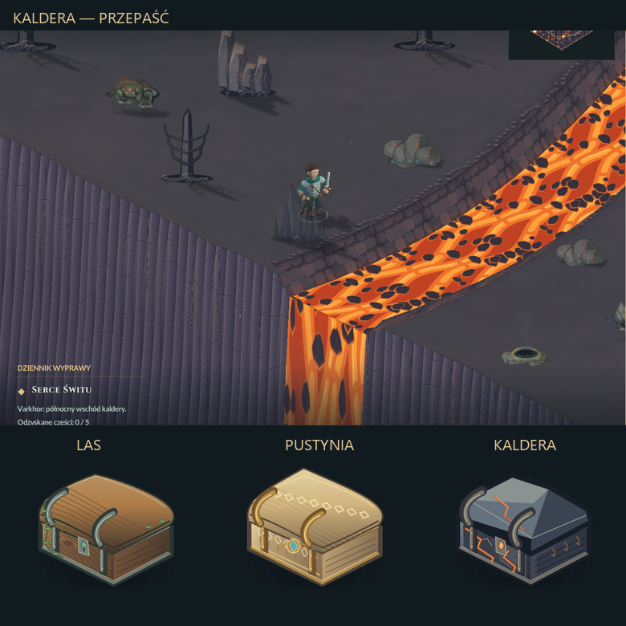

# Przepaść Kaldery i skrzynie krain — 08.11.2026

To wydanie zastępuje wcześniejsze obrzeże z kamieni. Powierzchnia mapy
kończy się przy granicy ruchu, a pod nią opadają wysokie, popękane ściany
bazaltu. Ich dolne części znikają we mgle. Narożniki są połączone na całej
głębokości. Nie ma podwyższonego murku ani rzędu kamieni.

Tło zawiera odległe skalne masywy, warstwy popiołu i żar w głębokich
szczelinach. Osobna warstwa sylwetek przesuwa się delikatnie z kamerą.
Obie rzeki kończą się na brzegu i spływają czterema wodospadami do otchłani.
Wykorzystują istniejące klatki lawy z Synfiga.



Skrzynie mają trzy style oraz trzy stany każdego stylu. Las: drewno, mech,
pnącza i żelazo; pustynia: jasna, rzeźbiona oprawa, złote okucia i turkus;
Kaldera: ciemne, fasetowane płyty, rozżarzone pęknięcia i runy. Zachowano
kotwicę podstawy, rozmiar w świecie, kolizję, zawartość i obsługę łupu.
Maska kliknięcia jest odczytywana z właściwego stanu i krainy.

Grafikę wykonano lokalnie w Kricie 5.3.4 za pomocą jej natywnego Python/Qt.
Na tym komputerze nie było wcześniej Krity ani skonfigurowanego MCP, dlatego
użyto oficjalnego przenośnego pakietu i dołączonego `kritarunner`. Nie
instalowano nowego serwera. SHA-256 pobrania i podpis KDE sprawdzono.
Nie użyto zewnętrznych grafik, modeli, chmury ani płatnych usług.

Źródła: `masters/realm-treasure-chests.kra` (1536×1536, siedem warstw) i trzy
finalne KRA w `masters/v2/`. Pierwsze wersje tła zachowano historycznie.
Eksport skrzyń ma 768×768, dziewięć komórek 256×256. Przebiegi i pełne
źródła pozostają w `C:/AI2D/sprites/emberfall-abyss-chests-20261108-v1`,
`...-v2` i `C:/AI2D/pipeline/krita-worker-20261108-v2`.
Worker zachowuje własne zapisane dokumenty w tle, bez wywoływania Close.

Produkcja: `tools/media/krita_asset_worker.py`, `krita_abyss_chests.py`
i `krita_abyss_refine.py`. Stany dokumentów sprzed zmian, rzeczywiste
podglądy Krity i potwierdzenia zapisu znajdują się w receiptach. Eksport
pierwszej skrzyni wznowiono z już zapisanego KRA po sprawdzeniu sygnatury
metody skalowania; master pozostał identyczny.

Weryfikacja: 1063 kontroli rzeczywistego renderera Kaldery, 115 obsługi
skrzyń we wszystkich sześciu miejscach i 31 niezależnych kontroli zasobów.
Sprawdzono przezroczyste otoczenie mapy, połączenia narożników, opadanie
ścian, każdy styl/stadium skrzyni, zaznaczanie, otwieranie, przenoszenie łupu
i opróżnianie. Raporty: `asset-QA.json`, `render-QA.json`, `chest-tests.txt`
oraz `package-QA.json`. Testy były ukryte, bez otwierania urządzenia audio.
Czasy ukończenia renderowania nie są pomiarem FPS widocznych na ekranie.

Dodatkowe tekstury wraz ze zwiększeniem atlasu i panoramy: ok. 16,23 MiB
RGBA8. Wszystko jest wczytywane przed grą. Czworokąty ścian są przygotowane
raz i rysowane w grupach, z odrzucaniem fragmentów poza kadrem. Bez nowego
bufora całej mapy, generowania grafik i I/O w pętli klatki. Format zapisu
oraz rewizja scenografii 4 pozostają zgodne z wcześniejszym wydaniem.

Odtworzenie testów:

```powershell
pwsh -NoProfile -File tests/volcano_qa.ps1 -NoAudio
pwsh -NoProfile -File tests/treasure_qa.ps1
pwsh -NoProfile -File tests/volcano_package_qa.ps1 -NoAudio -HelperRoot dist/<QA>
```

Kopie poprzedniego kodu, grafik i obu ZIP-ów:
`art/pipeline/backups/caldera-abyss-chests-20261108`.
