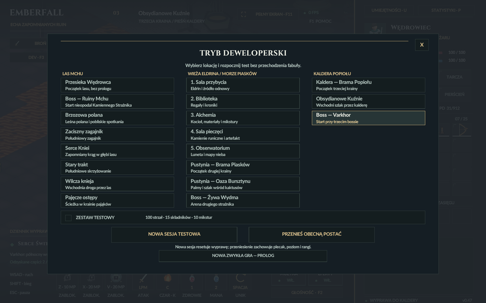

# Kaldera w trybie deweloperskim — 29.10.2026

Menu F3 ma 19 miejsc w trzech kolumnach. Nowa prawa kolumna:

| ID CLI | Przycisk | Start |
| --- | --- | --- |
| `volcano` | Kaldera — Brama Popiołu | bezpieczne wejście do krainy |
| `volcano-forges` | Obsydianowe Kuźnie | wschodni szlak (60;43) |
| `volcano-boss` | Boss — Varkhor | przy arenie (56;15) |

Aliasy: `kaldera`, `caldera`, `varkhor`. Stare ID i pozycje na liście są
zachowane. Nazwy i opisy mieszczą się w kartach przy skalach 80%, 100%, 120%.

`NOWA SESJA TESTOWA` tworzy nową postać i żywego trzeciego bossa.
`PRZENIEŚ OBECNĄ POSTAĆ` zachowuje poziom, ekwipunek, punkty, rangi i
stan przeciwników. Obie akcje wybierają wolne miejsce poza lawą i ciałami
bestii, odnawiają HP/manę i anulują pociski, erupcje, odrzut, upadek,
piaskową pułapkę oraz otwarte okna łupu. Zdobyte niewydane punkty zostają.

Sesja DEV w kalderze ustawia licznik wcześniejszych części na co najmniej 2
i flagę ukończenia drugiego bossa, aby działała podróż powrotna u Eldrina.
Nie dodaje części do plecaka ani rang umiejętności; Varkhor pozostaje żywy
w nowej wyprawie. Zwykły poziom i portal od maga zachowują swoje zasady.

Uruchamianie:

- W projekcie: `Tryb_deweloperski.bat`, następnie F3 i prawa kolumna.
- Szybko: `Test_kaldery.bat` albo `Test_Varkhora.bat`.
- Oddzielna paczka: `Emberfall-DEV-Windows-x64.zip`. Po wypakowaniu
  uruchom `Tryb_deweloperski.bat`; oba nowe skróty są obok EXE.
- CLI: `Emberfall.exe --start=volcano-boss --no-dev-kit`.

Produkcja paczki: `pwsh -NoProfile -File package-dev.ps1`.
Używa kompilacji deweloperskiej i zachowuje kopię poprzedniego archiwum DEV.
Zwykły `Emberfall-Windows-x64.zip` pozostaje wydaniem dla gracza.

Weryfikacja:

- `build.ps1 -Test`: 192848 kontroli logiki/animacji i 4078 zapisów — PASS.
- `tests/developer_volcano_qa.ps1 -NoAudio`: 257 kontroli rzeczywistego
  menu, tekstu, klikania, układu i bezpiecznego teleportu — PASS.
- `tests/developer_volcano_package_qa.ps1 -NoAudio -HelperRoot <helper>`:
  test świeżo wypakowanej paczki, 126 zasobów, trzy rzeczywiste starty
  po 180 klatek i ponowienie kontroli UI; `package-verification.json`.

Wszystkie testy mają `--no-audio --background-test` i ukryte okna; nie
przywracają fokusu. Nie zmieniają zapisanych preferencji dźwięku. Testy te
nie stanowią pomiaru FPS na ekranie. Poprzednie pliki zachowano w
`art/pipeline/backups/developer-volcano-20261029`.

