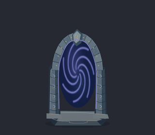

# Kaldera — animowana brama, ciągły grunt i ostrość obrazu

04.11.2026. Zintegrowano zmiany w EXE oraz paczkach gracza i DEV.
Grafika powstała lokalnie w Kricie 5.3.4.1, animacja w Synfigu 1.4.5.
Własne ilustracje 2D, bez płatnych usług, zewnętrznych grafik i modeli 3D.

## Rezultat

- Brama Eldrina ma rzeźbiony bazaltowy łuk, podstawę przylegającą do ziemi,
  runy i wirujący fioletowo-niebieski rdzeń. Natywny projekt Synfig zawiera
  pełny obrót i pulsowanie: 120 różnych klatek / 60 Hz / zamknięta pętla 2 s.
  Zachowano kolizję, powrót do wieży, maskę kliknięcia i obrys pod kursorem.
  Cień pochodzi ze stałej kamiennej ramy; świetlisty wir nie rzuca cienia.
- Nowy grunt ma zawiniętą fakturę popiołu i skały. Eksport to środkowe
  512 × 512 px natywnego płótna 1024 × 1024 px, z detalami malowanymi
  także po sąsiednich stronach. Nie ma ciemnego obramowania AO kafli.
  Duże plamy mają miękkie przejścia zamiast osobnych kanciastych płyt.
- Poprawiono ostatni etap wyświetlania całej gry. Gotowa klatka była
  ponownie mnożona przez alfę pokrycia, co przyciemniało wygładzone brzegi,
  także liter. Teraz RGB kopiowane jest 1:1; wyjście DXGI ma nieprzezroczystą
  alfę. Napisy nadal używają natywnych atlasów fontów i wyrównania do pikseli.
  Również świat Kaldery jest teraz rysowany w natywnej rozdzielczości.
  Las i pustynia zachowują oszczędniejszy bufor świata oraz natywny HUD.

GIF to 60 próbek z rzeczywistego renderera, z łącznym czasem 2 s.
W grze używane są wszystkie 120 klatek. [Pełny obraz z EXE DEV](previews/arrival-presented.png),
[porównanie tekstu](previews/text-before-after.png).

## Ostrość i odświeżanie — rzeczywiste pomiary

- Radeon: monitor 1920 × 1080, 60 Hz; Windows DPI 120 (125%).
  Zarówno API monitora, jak i uruchomiony EXE potwierdzają 60 Hz.
- DXGI flip / V-sync, żądany i rzeczywisty interwał prezentacji 1.
  180 startowych klatek EXE było synchronizowanych. Nie zmieniano ustawień
  ekranu Windows ani zapisanych preferencji dźwięku.
- Test końcowego RGB przed poprawką: 202592 różne piksele, największa
  różnica kanału 65/255. Po poprawce: zero różnic dla czterech odziedziczonych
  macierzy DPI (1, 1,25, 1,5 i 2). Osobno sprawdzono OpenGL i DXGI.
  To kontrola ścieżki prezentacji, nie cztery zmiany systemowego DPI.
- W próbie z oknem dekorowanym bufor i fizyczny obszar klienta miały
  dokładnie 1924 × 1055 px. Rzeczywisty ukryty EXE używa okna bez ramek:
  przy żądaniu 1920 × 1080 jednostek i DPI 125% klient oraz bufor mają
  2400 × 1350 fizycznych pikseli, a płótno 2160 × 1350 z bocznymi pasami.
  Odczyt Win32 potwierdził zgodność i Per-monitor DPI awareness.
  Nie ma dodatkowego rozciągania gotowego obrazu przez Windows.

Wszystkie okna testów pozostały ukryte, a audio nie zostało otwarte.
Ukryte testy nie potwierdzają foreground FPS ani jakości rytmu klatek na
ekranie. Dla sześciu scen paczki gracza ukończony render: średnio 5,53 ms,
p95 6,17 ms. To osobny pomiar renderowania, bez deklaracji stałych 60 FPS.

## Źródła i zasoby

- `masters/`: cztery edytowalne KRA, PNG oraz potwierdzenia natywnego zapisu.
  Warstwy rozdzielają ramę, runy, detale, pole portalu i fakturę gruntu.
- `motion/portal.sif`, `motion/parts/core.png`, receipt i log prawdziwego CLI.
- `provenance.json`: lokalizacje, SHA-256, autorstwo i użyte darmowe narzędzia.
- `checks/`: log renderera, pomiary przed/po i raporty obu wypakowanych paczek.
- `QA.json` i `asset-verification.json`: zbiorczy wynik oraz niezależny odbiór.

Pełne natywne logi MCP i wszystkie 120 klatek pozostają w:

- `C:\AI2D\sprites\emberfall-caldera-gateway-20261104`
- `C:\AI2D\animations\emberfall-caldera-gateway-20261104`
- etap eksportu: `C:\AI2D\pipeline\caldera-gateway-20261104\runtime`
- kopie poprzednich plików, kodu, pakowania i obu ZIP-ów:
  `C:\AI2D\pipeline\backups\caldera-gateway-20261104`

Zapisane dokumenty Krita pozostawiono otwarte zgodnie z obejściem awarii
zamykania edytowanych KRA. Każda produkcja miała `krita_state` przed edycją
i `krita_preview` po edycji, z jawnymi ID dokumentów i warstw.

Runtime: `assets/volcano/portal-frame.png`, `portal-loop.png`, `portal-mask.png`,
`portal-outline.png`, `ground.png`, `macro.png`. Atlas portalu 1980 × 1696,
stałe komórki 132 × 212, 2 px odstępu. Trzy dodatkowe tekstury to 14757120
bajtów RGBA8 (14,07 MiB), maska CPU 165600 bajtów. Wszystko ładowane raz;
animacja wybiera komórkę po czasie, bez generowania i I/O w pętli klatki.
Zapis nadal v10, rewizja scenografii 3, mechaniki i fabuła zachowane.

## Odtwarzanie

Używaj Pythona wskazanego w AGENTS.md oraz rzeczywistego PowerShell 7.
Wybieraj nowe katalogi produkcji; przed podmianą plików zrób kopię.

1. `tools/media/caldera_gateway_art.py --root <nowy-sprites> --runtime <nowy-eksport> --no-audio`
   tworzy warstwowe dokumenty przez istniejący lokalny Krita MCP.
2. `tools/media/caldera_gateway_synfig.py --root <nowe-animations> --paints <sprites> --runtime <eksport> --no-audio`
   zapisuje SIF, renderuje 120 PNG przez CLI Synfig (dwa wątki) i pakuje atlas.
3. Po kontroli zastąp wyłącznie sześć powyższych PNG w `assets/volcano`.
4. `tests/image_clarity_probe.ps1 -NoAudio -OutputName <nowy-katalog>`
   sprawdza ukrytą prezentację DXGI bez przełączania pełnego ekranu.
5. `tools/media/verify_caldera_gateway.py --paints <sprites> --motion <animations> --runtime assets/volcano --before <poprzedni-summary.json> --after <nowy-summary.json> --output <nowy-raport.json> --no-audio`.
6. `build.ps1 -Test`, `tests/volcano_qa.ps1 -NoAudio -OutputName <nowy-katalog>`,
   `package.ps1`, a następnie `tests/volcano_package_qa.ps1 -NoAudio -HelperRoot <helper>`.
   `package-dev.ps1 -NoBuild` pakuje aktualny EXE DEV.

Nie uruchamiaj starych testów przełączających pełny ekran przy wymaganiu
ukrytych okien. Rzeczywisty EXE testuj zawsze z `--no-audio --background-test`.
Pakowanie gracza pobiera kanoniczną listę `assets`, aby nie dołączać starych
diagnostycznych plików z wcześniej używanego katalogu kompilacji.

## Wyniki końcowe

PASS: 293 kontrole natywnych źródeł/klatek/ciągłości/prezentacji, 787
renderera i interakcji, 194309 logiki/animacji oraz 4090 zapisu.
Wypakowana finalna paczka gracza: 143 zgodne zasoby, 180 klatek startu
i ponownie 787 kontroli renderera. DEV: 143 zgodne zasoby i 540 klatek
w trzech punktach Kaldery. Brak masterów w ZIP-ach, preferencje audio
zachowane. Hashy i szczegóły nie zastępują oględzin: sprawdzono też wygląd
portalu, płynność jego pętli, ciągłość gruntu i rzeczywisty tekst wyjściowy.
