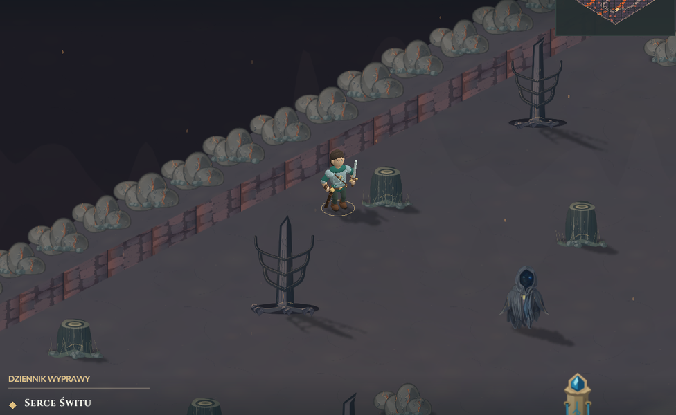
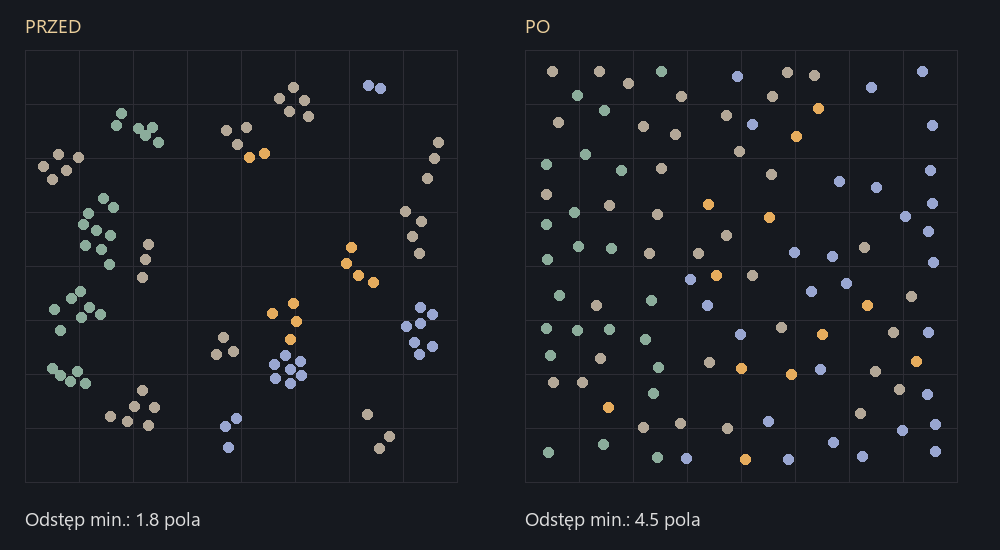

# Granice i rozmieszczenie terenu Kaldery — 08.11.2026

**Aktualny brzeg to przepaść:** [urwiska, tło oddali i nowe skrzynie](../abyss/README.md).
Poniższe kamienne obrzeże jest historyczne. Rozmieszczenie terenu i migracja
rewizji 4 pozostają aktualne.

Kaldera ma ciągłe skalne obrzeże przy rzeczywistej granicy ruchu. Odległy
brzeg jest wyższy, a bliższy niższy, żeby zachować widok na bohatera.
Poza granicą podłoże jest przyciemnione. Rzeki zachowują otwarte dopływy;
lawa nadal blokuje przejście. Kontur widać także na minimapie.



Wykorzystano istniejące ilustracje bazaltu, podłoża i ścian koryta z Krity.
Obrzeże jest wypiekane raz w istniejącym buforze terenu. Nie dodano tekstur,
buforów mapy, modeli ani kosztu rysowania obrzeża w każdej klatce.

Rozmieszczenie dekoracji wybiera największe pozostałe wolne przestrzenie
spośród nieregularnych, deterministycznych kandydatów. Zachowano regionalne
materiały: spalone drzewa na zachodzie, skały i fumarole w środku, obsydian
na wschodzie. Mniejsze różnice skali i większe odstępy ograniczają nakładanie
dużych elementów. Drogi, mosty, podejścia do obiektów i arena pozostają wolne.



Świeża Kaldera: 101 dekoracji i jeden portal. Minimalny odstęp wzrósł
z 1,77 do 4,45 pola. Największy pusty promień w próbce terenu przeznaczonego
na dekoracje spadł z 13,53 do 4,97 pola. Nie liczymy celowo wolnych szlaków,
areny, wejścia, otoczenia przeciwników ani obiektów do interakcji.

Rewizja scenografii 4, format zapisu nadal v10. Prawdziwy zapis poprzedniej
rewizji jest w `fixtures/revision-3-v10.efs`. Aktualizacja zmienia wyłącznie
dekoracje i numer rewizji: test porównuje wszystkie pozostałe bajty zapisu.
Pomija przeszkody w miejscu bohatera oraz aktualnych pozycjach przeciwników.
Nie korzysta z generatorów losowych rozgrywki. Aktualizacja jest jednorazowa.

Weryfikacja bez audio i w ukrytych oknach: 199995 kontroli logiki/animacji,
4513 zapisu oraz 820 renderera, w tym 12 ujęć obrzeża i rozłożenia terenu.
Sprawdzono dostęp do wszystkich spotkań, bossa, obu skrzyń i kapliczek.
`render-QA.json` zawiera niezależne pomiary, a `package-QA.json` kontrolę
gotowych wydań. Czas ukończenia renderowania nie jest pomiarem FPS ekranu.

Powtórzenie:

```powershell
pwsh -NoProfile -File tests/volcano_qa.ps1 -NoAudio
python tools/media/verify_caldera_layout.py --root art/volcano/layout --captures dist/<QA>/checks --no-audio
pwsh -NoProfile -File tests/volcano_package_qa.ps1 -NoAudio -HelperRoot dist/<QA>
```

`tests/caldera_layout_probe.cpp` odtwarza pomiary z aktualnej gry; `before.json`
i fixture rev3 pochodzą z jego kompilacji przed zmianą. Kopie wcześniejszego
kodu i obu ZIP-ów: `art/pipeline/backups/caldera-layout-20261108`.
