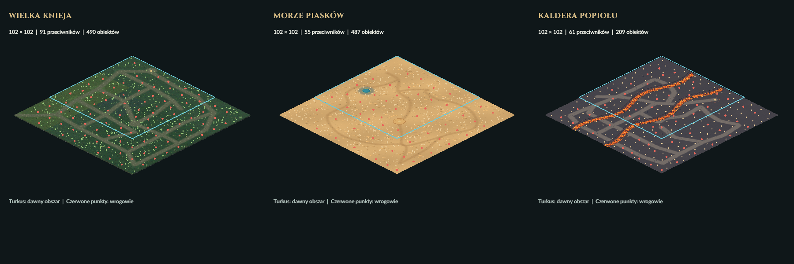

# Rozbudowa trzech krain — 08.11.2026

Siatka każdego świata: **72 × 72 → 102 × 102**, czyli 5184 → 10404 pola
(2,00694 × dawna powierzchnia). Mapa rośnie na wschód i południe, zachowując
oryginalne pozycje trzech strażników, skrzyń, portali i kapliczek.

| Kraina | Przeciwnicy wcześniej / teraz | Obiekty terenu teraz | Wzniesienia teraz |
| --- | --- | --- | --- |
| Wielka Knieja | 46 / 91 | 490 | 28 |
| Morze Piasków | 28 / 55 | 487 | 28 |
| Kaldera Popiołu | 31 / 61 | 209 | 32 |

Podwojono liczbę zwykłych spotkań, pozostawiając po jednym strażniku fabularnym.
Nowi przeciwnicy mają te same statystyki i tabele łupu, a kobra, skarabeusz,
wojownik i drak zachowują swoje zdolności. Dodane tereny mają ścieżki,
polany, wzgórza i własne grupy istniejącej scenografii. W lesie nadal jest
48 grzybów zgodnie z wcześniejszym ograniczeniem liczby roślin.

Las: 35 odcinków szlaków i 12 polan; początek nowej gry pozostaje przy
zachodnim krańcu pola. Pustynia: sześć krzywych tras, z obejściem oazy
i skrzyni w ruinach, oraz wydmy na całej nowej powierzchni. Kaldera:
dziewięć połączonych dróg, osiem rzeczywistych mostów (cztery nowe),
przedłużona lawa i urwiska. Wszystkie nowe i stare spotkania oraz dalekie
krańce map mają połączenie z wejściami przez faktyczne kolizje terenu.

Zapis **v12** przechowuje rewizję rozszerzenia. Przy odczycie v1–v11
uzupełniane są istniejące krainy, także zachowane poza ekranem. Pierwotne
obiekty przeciwników i ich ciała nie są zastępowane. Zachowane są pozycje,
HP, fazy walki, łup, rośliny, przedmioty gracza, skrzynie, zużyte kapliczki,
zadania i oba strumienie RNG. Las/pustynia zachowują starą scenografię;
nowe obiekty dochodzą za dawną granicą. Rewizja 5 scenografii Kaldery
uwzględnia nowych mieszkańców i drogi, chroniąc aktualną pozycję bohatera.
Nieodwiedzone krainy pozostają nieutworzone do pierwszej podróży. Powtórne
wczytanie ani podróż nie powiela mieszkańców i nie wskrzesza strażników.

Odbiór migracji korzysta m.in. z trzech rzeczywistych zapisów **v11**
utworzonych przed zmianą map (`fixtures/*-v11.efs`). Testy porównują bajtowo
stan każdego pierwotnego przeciwnika i wszystkich pól postępu, dopuszczając
wyłącznie świadome dodanie nowej zawartości i aktualizację scenografii.
Starsze fixture v1–v10 nadal przechodzą. Oryginały robocze i ZIP-y sprzed
zmiany: `art/pipeline/backups/world-expansion-20261108`.

Grafika: istniejące materiały 2D i postacie, bez nowych bitmap, modeli lub
usług. Bufor podłoża ma 6270 × 3285 pikseli, poniżej limitu 8192, przy pełnych
współrzędnych świata dla geometrii i interakcji. Każdy bufor to 82 387 800
bajtów RGBA8, około 8,7% więcej niż poprzedni, mimo podwojenia obszaru.
Mapa maski dróg i UV podniesionego podłoża zostały dostosowane do nowego
rozmiaru. Podłoże i drogi przygotowywane są przy starcie, bez generowania
lub odczytu zasobów w zwykłych klatkach gry.

PASS: 234833 kontrole logiki/animacji, 10157 zapisów, trzy pełne pomiary
bezpiecznej projekcji terenu i 184 kontrole renderera z 21 obrazami.
Testy graficzne są ukryte, z wyłączonym audio. Ukończona aktualizacja + render:
średnia 8,47 ms, p95 10,62 ms; nie jest to pomiar FPS widocznego okna.
Raporty i końcowy odbiór paczek: `QA.json`.

Obie paczki sprawdzono po wypakowaniu: po 228 zgodnych zasobów i zgodne
pliki EXE, bez masterów lub zapisów gracza. Wersja gracza: 180 klatek startu
i ponowne 184 kontrole z zasobami ZIP-a; DEV: po 180 klatek trzech krain.
Sprawdzono oryginalny hash preferencji audio użytkownika — bez zmian.

